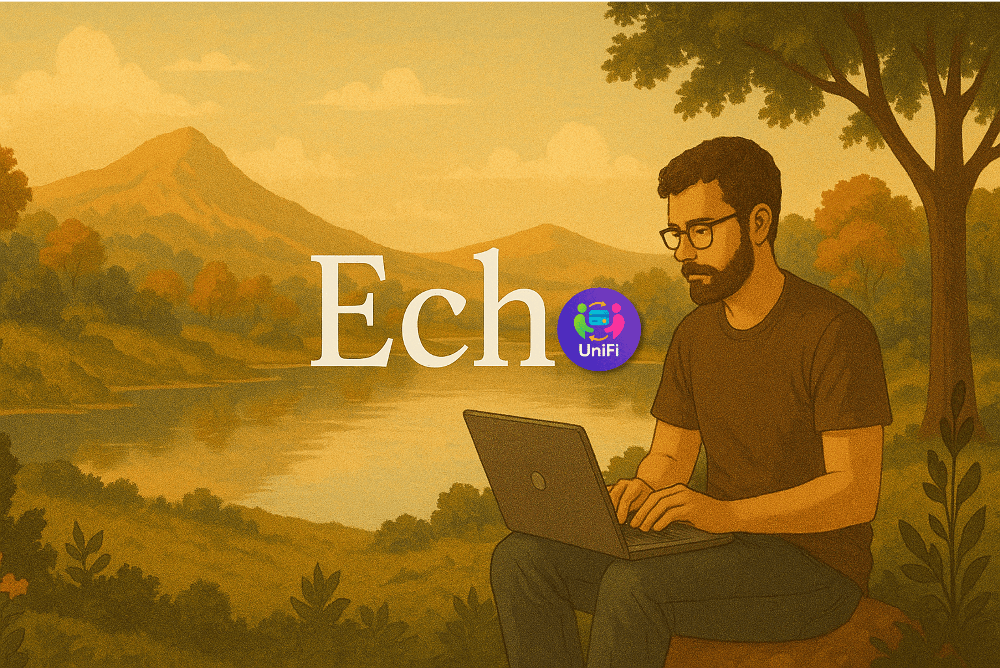

# UniFi Echo

> 🍃 Rooted in nature 🍁, 🌱 branching into decentralized finance — 🧑🏻‍💻 **echoing** ideas 💡 into a 🌍 borderless financial world.

<p align="left">
  
</p>

## API

Need direct HTTP access? Jump into the REST API docs → [Open API Docs](./api-http/README.md)

## SDK

| Language | SDK | Primitives | Examples |
| --- | --- | --- | --- |
| Rust | [`unifi-sdk-rs`](./sdk/rust/) | [`unifi-sdk-primitives`](./primitives/rust/) | [Rust examples](./examples/rust/README.md) |
| TypeScript | [`unifi-sdk-ts`](./sdk/typescript/README.md) | [Types and helpers](./primitives/typescript/src/) | [TypeScript examples](./examples/typescript/) |

Install the TypeScript SDK from a commit that includes it in the public developer kit.
Replace `COMMIT_SHA` with that commit's SHA.

```sh
npm install 'git+https://github.com/abhi3700/unifi-dev-kit.git#COMMIT_SHA'
```

Import the client from `unifi-sdk-ts` and the shared types and helpers from `unifi-sdk-ts/primitives`.
From this directory, run `npm ci` and `npm test` to build and test the TypeScript SDK.
Run `cargo check --workspace` for the Rust workspace.

The [self-custodial payment guide](./examples/self-custodial-payments.md) covers approval,
Permit2 signing, and receipt tracking for single and bulk payments in both languages.
